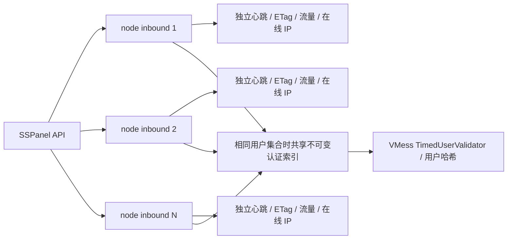

# 最终架构

## 数据流

## 每个入站保留的状态

- node_id 和节点信息请求
- `/users` 请求及其独立 ETag / Last-Modified
- 节点用户投影
- 用户流量计数和上报进度
- 在线 IP 集合
- 连接限制计数
- 用户级业务对象

因此，共享认证索引不会合并 node 心跳，也不会把不同节点的连接数和流量归属混在一起。

## 可共享的不可变认证索引

共享条件包括：

- 用户集合相同
- user ID 相同
- 内部 email 映射相同
- UUID 相同
- alterId 相同
- level 相同

条件不满足时自动拆成不同认证桶。共享对象只包含 `TimedUserValidator`、VMess account 和认证哈希索引，不包含节点业务计数。

## alterId 与内存

VMess `TimedUserValidator` 会为主 ID 和每个 legacy alter ID 预生成约 241 秒时间窗口的认证哈希。对于大量启用 `alterId: 32` 的用户，这是主要的常驻内存来源。

最初每个入站建立一套 validator，导致同一用户集合在多入站场景下重复生成索引。最终方案将用户集合完全相同的 validator 合并为一个，同时保持每入站业务状态独立。

`alterId: 0` 不产生 legacy alter ID 哈希，因此内存明显低于纯 `alterId: 32` 场景。服务端以 32 个 alter ID 建立账户时，仍可接受 alterId 0 的 AEAD 主身份和 alterId 32 的 legacy 身份。

## SSPanel 响应去重

同步路径按以下顺序减少重复工作：

1. 优先使用 ETag/If-None-Match。
2. 支持 Last-Modified/If-Modified-Since。
3. 无 304 时计算响应正文 SHA-256；正文未变化则不重复 JSON 解码，也不重建认证索引。
4. 用户集合发生变化时构建新 bucket，再原子替换入站认证指针。
5. 失败时保留上一份有效用户集合，等待下一轮刷新。

正文哈希不是心跳。即使内容未变化，每个 node_id 仍必须完成自己的 `/users` HTTP 请求。

